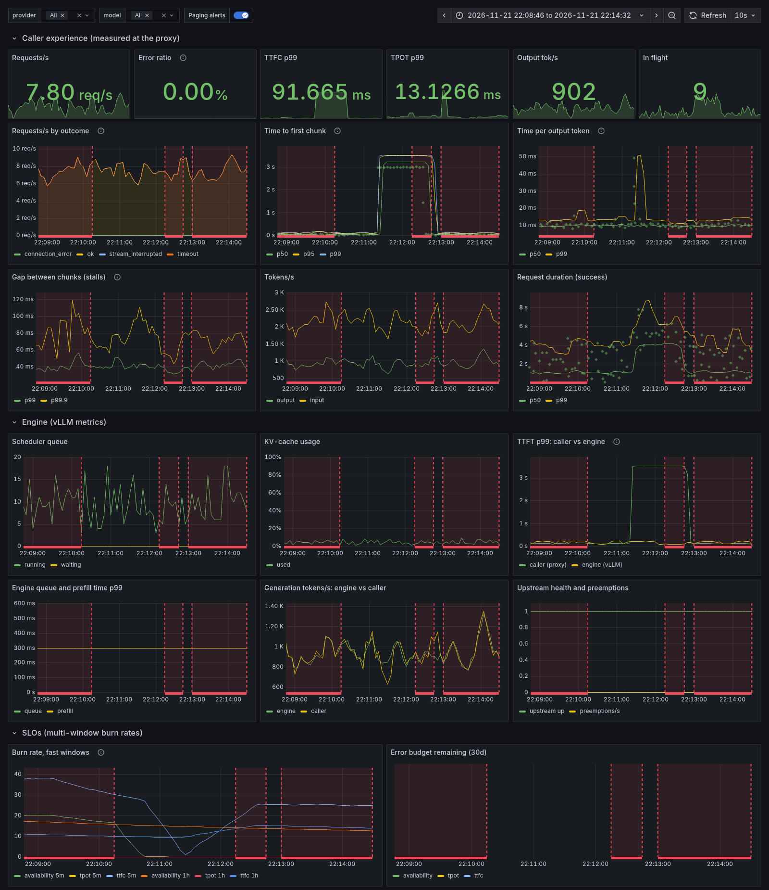
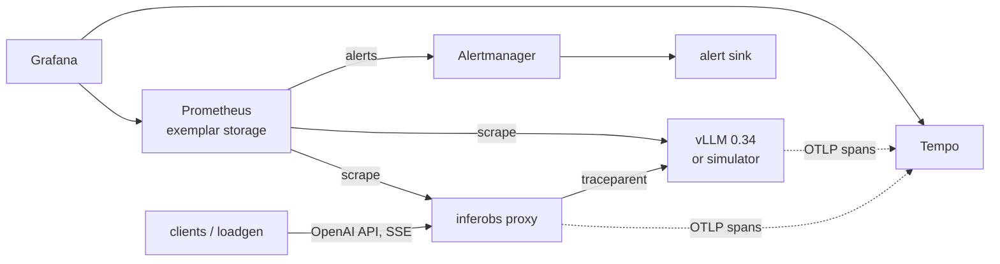
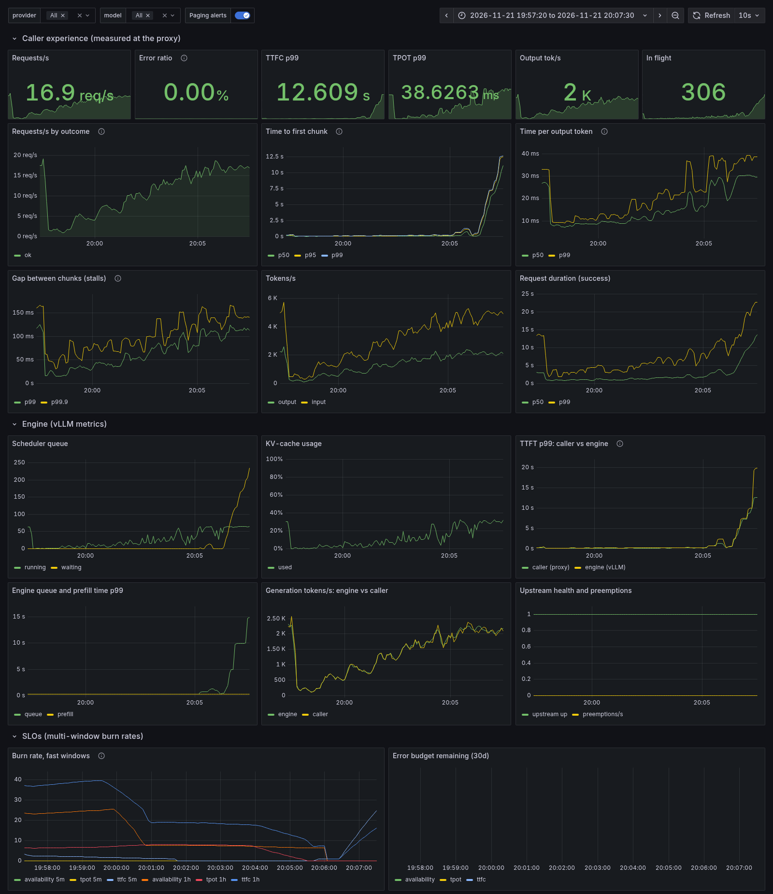

# inference-observability-stack

Observability for LLM inference serving, measured against a real engine: a streaming metering proxy,
SLO burn-rate alerting, distributed traces that cross into vLLM, and experiments that check whether
the numbers on the dashboard are the numbers callers actually got.

<!-- BEGIN GENERATED: setup -->
Measured on one NVIDIA GeForce RTX 3050 Ti Laptop GPU (4 GB), vLLM 0.34.0 serving Qwen2.5-0.5B-Instruct (bf16), on a shared 20-thread i7-12700H laptop. Prometheus scrapes every 5 s. Workload: lognormal prompts (mean 256 words) and outputs (mean 128 tokens, `ignore_eos`).
<!-- END GENERATED: setup -->

## Results

<!-- BEGIN GENERATED: headline -->
- **The proxy's latency cost is below what 629 paired requests can resolve:** at 32 streams TTFT changes by +1.7 ms at p50 (95% CI -1.79 to 5.71 ms) and -3.5 ms at p99 (-19.25 to 12.47 ms). It costs 149 us of CPU per streamed token with every request traced.
- **The dashboard's TTFT p99 is within 4.8% of the exact value** computed from every request in the access log.
- **vLLM's default buckets misreport TPOT p99 by +92%** on this GPU (true value 12.8 ms, inside its 10 to 25 ms bucket, so PromQL interpolates across a wide range); the proxy's layout is off by +2.9%.
- **A 3 s network delay is caught by the caller-side TTFC SLO in 60 s (median); the engine's own TTFT never moves** (EngineTTFTHigh did not fire).
- **Capacity at SLO: 14.8 req/s** (1,820 output tok/s) before TTFT p99 passes 1 s or TPOT p99 passes 50 ms.
<!-- END GENERATED: headline -->

Every number in this README is generated by `scripts/gen_readme.py` from the CSVs in `results/`
(CI fails if the README and the results disagree).



*The dashboard during the 3 s network-delay fault, rendered from the run's own Prometheus data with
`scripts/render_dashboard.sh`. Caller-side time to first chunk steps up by the injected delay; in the
"TTFT p99: caller vs engine" panel, vLLM's own TTFT does not move.*

## What it is



- **`inferobs proxy`** sits in front of any OpenAI-compatible engine and forwards requests and SSE
  streams unchanged while measuring what the caller experiences: time to first chunk (observed when
  the chunk arrives, not when the request ends), every gap between chunks, mean time per output
  token, duration and token usage. Metric names follow the OpenTelemetry GenAI semantic conventions
  (client side, v1.41.0). It asks the engine for stream usage and hides that extra chunk from clients
  that did not ask, bounds model-label cardinality, aborts the upstream request when a client
  disconnects, and labels failures (`timeout`, `connection_error`, `stream_interrupted`, HTTP status,
  `cancelled`). Each request gets a span whose trace context is forwarded to the engine, a trace-id
  exemplar on its histogram samples, and an optional JSON access-log line.
- **`inferobs sim`** is a continuous-batching engine simulator (FCFS admission, chunked prefill,
  KV-cache budget, linear step-cost model) that exposes vLLM 0.34's metric names and buckets and takes
  runtime faults (slowdown, error rate, hang). CI runs the whole stack on it without a GPU.
- **`inferobs loadgen`** generates open-loop (Poisson) or closed-loop streaming load and records
  per-request ground truth, measuring latency from each request's scheduled arrival so a backed-up
  client cannot hide queueing (coordinated omission).
- **`inferobs slo gen`** turns `slo/slo.yaml` into recording rules and multi-window, multi-burn-rate
  alerts (SRE workbook tiers: 14.4x over 1 h and 5 m pages, 6x over 6 h and 30 m pages, 3x and 1x
  tickets). Latency thresholds are checked against the histogram bucket bounds; `window_scale`
  compresses every window for lab use.
- **`deploy/`**: Docker Compose stack (Prometheus 3.5 with exemplar storage, Tempo 2.8, Grafana 12,
  Alertmanager, toxiproxy for network faults), a generated Grafana dashboard that puts the caller's
  view next to the engine's, symptom alerts, and promtool unit tests for every alert.

### SLOs

| SLO | objective | SLI (measured at the proxy) |
|---|---|---|
| availability | 99.5% | requests without an error; client cancellations excluded |
| ttfc | 99% | streaming requests whose first chunk arrives within 1 s |
| tpot | 99% | requests whose mean time per output token is at most 50 ms |

## Experiments

### 1. What metering costs

<!-- BEGIN GENERATED: overhead -->
| streams | target | requests | TTFT p50 | TTFT p99 | TTFT p50 delta (95% CI) | TTFT p99 delta | TPOT p50 delta | proxy CPU | CPU per token |
|---|---|---|---|---|---|---|---|---|---|
| 1 | direct | 50 | 31.77 ms | 64.15 ms |  |  |  |  |  |
| 1 | proxy | 50 | 34.88 ms | 97.31 ms | 3.11 ms (-1.15 to 6.89) | 33.16 ms | 3 us | 1.2% | 250 us |
| 1 | proxy+tracing | 50 | 33.54 ms | 71.58 ms | 1.78 ms (-2.61 to 7.09) | 7.43 ms | 0 us | 1.1% | 259 us |
| 8 | direct | 302 | 47.30 ms | 105.89 ms |  |  |  |  |  |
| 8 | proxy | 302 | 47.97 ms | 107.62 ms | 0.67 ms (-1.42 to 2.89) | 1.74 ms | 63 us | 4.5% | 165 us |
| 8 | proxy+tracing | 301 | 48.44 ms | 98.89 ms | 1.14 ms (-0.14 to 3.48) | -6.99 ms | -12 us | 4.5% | 169 us |
| 32 | direct | 628 | 84.58 ms | 174.61 ms |  |  |  |  |  |
| 32 | proxy | 629 | 86.28 ms | 171.12 ms | 1.69 ms (-1.79 to 5.71) | -3.49 ms | -54 us | 8.3% | 146 us |
| 32 | proxy+tracing | 628 | 84.37 ms | 173.94 ms | -0.21 ms (-2.98 to 3.74) | -0.67 ms | -132 us | 8.4% | 149 us |

Each row group is one 150 s closed-loop run whose requests rotate through the three targets, so every target sees the same engine state; deltas are against `direct` in the same run, with bootstrap 95% intervals. Requests scheduled in the first 10 s of each run are excluded: all workers start at once, and which target lands in a later prefill wave of that first burst depends on sub-millisecond arrival order (it made the unfiltered p99 look 180 ms worse through the proxy). Separate runs per target were tried first and discarded: this laptop GPU runs power-capped (SM clock 1.3 of 2.1 GHz under load) and its speed drifts between runs by more than the proxy costs. Proxy CPU is that proxy process's CPU time over wall time (100% = one core) while serving a third of the requests. Source: `results/box-3050ti/overhead.csv`, commit `49adce6`.
<!-- END GENERATED: overhead -->

### 2. Do the caller, the proxy, Prometheus and vLLM agree?

<!-- BEGIN GENERATED: agreement -->
| metric | q | client | proxy (exact) | proxy (Prometheus) | vLLM (Prometheus) |
|---|---|---|---|---|---|
| TTFT | p50 | 50.57 ms | 48.79 ms | 49.00 ms | 47.86 ms |
| TTFT | p99 | 118.59 ms | 116.67 ms | 122.30 ms | 193.38 ms |
| TPOT (per request) | p50 | 9.53 ms | 9.53 ms | 9.56 ms | 7.11 ms |
| TPOT (per request) | p99 | 12.77 ms | 12.77 ms | 13.13 ms | 24.50 ms |
| gap between chunks | p50 | 8.23 ms | 8.23 ms | 8.43 ms | 5.43 ms |
| gap between chunks | p99 | 43.25 ms | 42.92 ms | 44.53 ms | 45.45 ms |
| end to end | p50 | 1,072.65 ms | 1,071.15 ms | 1,085.52 ms | 1,089.19 ms |
| end to end | p99 | 4,079.06 ms | 4,077.94 ms | 4,075.81 ms | 4,743.90 ms |

Per request (matched by `X-Request-Id`), the client saw TTFT 1.61 ms later than the proxy at p50 and 3.50 ms at p99: the loopback hop and the client's own event loop. 

2131 requests at 7.4 req/s for 300 s. Source: `results/box-3050ti/agreement.csv`, commit `44bcab0`.
<!-- END GENERATED: agreement -->

### 3. How wrong are histogram quantiles with each bucket layout?

<!-- BEGIN GENERATED: buckets -->
| metric | q | exact | vLLM default | OTel semconv | inferobs fine |
|---|---|---|---|---|---|
| TTFT | p50 | 48.79 ms | +5.4% | +5.4% | +0.4% |
| TTFT | p99 | 116.67 ms | +75.7% | +75.7% | +4.8% |
| TPOT | p50 | 9.53 ms | -25.9% | -25.9% | +0.3% |
| TPOT | p99 | 12.77 ms | +91.8% | +91.8% | +2.9% |
| gap between chunks | p50 | 8.23 ms | -30.6% | -30.6% | +2.4% |
| gap between chunks | p99 | 42.92 ms | +9.8% | +9.8% | +3.7% |
| end to end | p50 | 1,071.15 ms | +2.3% | +2.8% | +1.3% |
| end to end | p99 | 4,077.94 ms | +16.3% | +17.9% | -0.1% |

Error of PromQL `histogram_quantile` against the exact quantile of the same observations (every request and chunk gap from the agreement run, re-bucketed per layout with a reimplementation of PromQL's interpolation in `inferobs/analysis/stats.py`). Bounds per histogram: vLLM default 19 to 22, OTel semconv 13 to 16, inferobs fine 51 to 57. vLLM 0.34 uses the OpenTelemetry advisory boundaries (plus a longer tail), so those two columns match except end to end; its lowest inter-token bound is 10 ms, above this GPU's median decode step. vLLM 0.34 accepts `--custom-histogram-buckets` to fix this. Source: `results/box-3050ti/agreement_buckets.csv`, commit `44bcab0`.
<!-- END GENERATED: buckets -->

### 4. Saturation

<!-- BEGIN GENERATED: saturation -->
| offered req/s | TTFT p50 | TTFT p99 | TPOT p99 | output tok/s | running | waiting | KV peak | meets SLOs |
|---|---|---|---|---|---|---|---|---|
| 1.7 | 36.9 ms | 91.3 ms | 8.79 ms | 177 | 1.1 | 0.0 | 1% | yes |
| 4.4 | 46.7 ms | 114.7 ms | 10.92 ms | 560 | 5.2 | 0.0 | 4% | yes |
| 7.0 | 45.6 ms | 116.2 ms | 11.83 ms | 784 | 8.2 | 0.0 | 6% | yes |
| 9.6 | 56.9 ms | 128.0 ms | 15.18 ms | 1,264 | 16.1 | 0.0 | 11% | yes |
| 12.2 | 73.2 ms | 187.5 ms | 21.65 ms | 1,691 | 24.9 | 0.0 | 15% | yes |
| 14.8 | 80.7 ms | 210.3 ms | 23.64 ms | 1,820 | 30.1 | 0.0 | 28% | yes |
| 17.4 | 152.8 ms | 1,153.6 ms | 33.62 ms | 2,229 | 52.9 | 4.6 | 32% | **no** |
| 20.0 | 10,200.4 ms | 14,938.8 ms | 36.57 ms | 2,576 | 63.5 | 161.9 | 32% | **no** |

Open-loop Poisson arrivals, 75 s per stage, first 30 s of each stage excluded. Caller columns from the load generator, engine columns from vLLM's metrics over the same window. Source: `results/box-3050ti/saturation.csv`, commit `44bcab0`.
<!-- END GENERATED: saturation -->



*The same ramp on the dashboard: request rate climbs stage by stage until the scheduler queue and the
caller's TTFC take off together in the last stage.*

### 5. Which signal catches which fault, and how fast?

<!-- BEGIN GENERATED: faults -->
| fault | alert | should | fired | detection (median, range) |
|---|---|---|---|---|
| engine_crash | InferenceEngineScrapeDown | fire | 2/2 | 36 s (35 to 36) |
| engine_crash | InferenceUpstreamUnhealthy | fire | 2/2 | 38 s (36 to 40) |
| engine_crash | SLOErrorBudgetBurnFast:availability | fire | 2/2 | 36 s (36 to 37) |
| engine_hang | InferenceEngineScrapeDown | fire | 2/2 | 40 s (40 to 40) |
| engine_hang | InferenceUpstreamUnhealthy | fire | 2/2 | 42 s (40 to 45) |
| engine_hang | SLOErrorBudgetBurnFast:availability | fire | 2/2 | 91 s (91 to 91) |
| net_latency | CallerTTFCHigh | fire | 2/2 | 75 s (75 to 75) |
| net_latency | EngineTTFTHigh | stay silent | 0/2 | not fired |
| net_latency | SLOErrorBudgetBurnFast:ttfc | fire | 2/2 | 60 s (57 to 62) |
| stream_cut | EngineTTFTHigh | stay silent | 0/2 | not fired |
| stream_cut | InferenceEngineScrapeDown | stay silent | 0/2 | not fired |
| stream_cut | SLOErrorBudgetBurnFast:availability | fire | 2/2 | 28 s (18 to 37) |
| overload | CallerTTFCHigh |  | 2/2 | 76 s (76 to 76) |
| overload | EngineQueueBacklog | fire | 2/2 | 74 s (71 to 76) |
| overload | EngineTTFTHigh |  | 2/2 | 66 s (66 to 66) |
| overload | SLOErrorBudgetBurnFast:availability |  | 1/1 | 59 s |
| overload | SLOErrorBudgetBurnFast:ttfc | fire | 2/2 | 38 s (38 to 38) |
| slow_decode | SLOErrorBudgetBurnFast:tpot | fire | 0/2 | not fired |
| slow_decode | SLOErrorBudgetBurnFast:tpot@30m |  | 1/1 | 237 s |

Detection is the first Prometheus evaluation with the alert firing after injection, with the compressed-window SLO rules (window_scale 1/12: the 1 h/5 m fast-burn page becomes 5 m/25 s) and a background load of 7.4 req/s. vLLM took 22 to 24 s to serve again after a restart. Source: `results/box-3050ti/faults.csv`, commit `49adce6`.

What each fault did, before (the minute before injection) to during (from 30 s after injection), median over repeats:

| fault | caller TTFC p50 | caller TTFC p99 | caller chunk gap p50 | caller errors | vLLM TTFT p99 |
|---|---|---|---|---|---|
| engine_crash | 52.6 ms to n/a | 137.8 ms to n/a | 8.6 ms to n/a | 0.0% to 100.0% | 211.4 ms to n/a |
| engine_hang | 49.7 ms to n/a | 124.4 ms to n/a | 8.5 ms to n/a | 0.0% to 100.0% | 200.3 ms to n/a |
| net_latency | 51.1 ms to 3,233.5 ms | 119.5 ms to 3,521.6 ms | 8.6 ms to 8.6 ms | 0.0% to 0.0% | 188.4 ms to 157.3 ms |
| stream_cut | 49.3 ms to 41.6 ms | 119.7 ms to 96.9 ms | 8.5 ms to 7.4 ms | 0.0% to 100.0% | 207.5 ms to 94.5 ms |
| overload | 50.8 ms to 24,726.4 ms | 117.1 ms to 26,179.6 ms | 8.5 ms to 24.4 ms | 0.0% to 16.3% | 151.7 ms to 39,780.1 ms |
| slow_decode | 51.8 ms to 170.2 ms | 126.3 ms to 840.4 ms | 8.5 ms to 21.6 ms | 0.0% to 0.0% | 198.6 ms to 1,164.4 ms |

Caller columns are the proxy's histograms; vLLM's are its own. Source: `results/box-3050ti/fault_effects.csv`, commit `60401a3`.
<!-- END GENERATED: faults -->

`slow_decode` runs a matrix-multiply loop on the same GPU. It slows every decode step, but per-request
TPOT stays under the 50 ms objective, so the fast TPOT page correctly stays quiet: by the SLO's
definition callers are still served well enough. A tighter TPOT objective, or a ticket on the
chunk-gap trend, would catch it.

### 6. One request, one trace

<!-- BEGIN GENERATED: trace -->
```text
inferobs-proxy  chat qwen2.5-0.5b-instruct    246.0 ms   TTFC 18.41 ms, 32 output tokens
vllm            llm_request                   242.5 ms   queue 0.02 ms, prefill 12.66 ms, TTFT 15.85 ms, decode 226.31 ms, 32 output tokens
```

One request, one trace: the proxy's client span and vLLM's server span share the trace ID the caller sent, and vLLM's span carries its own queue/prefill/decode split. The caller-side first chunk came 2.6 ms after vLLM's own first token: the API server's HTTP/SSE path and the proxy hop, which no engine metric includes. Source: `results/box-3050ti/trace_example.json`.
<!-- END GENERATED: trace -->

## What the measurements caught

Building the experiments surfaced problems that would also bite a production setup:

- **TTFT recorded at the end of the request is late by the whole generation.** The first proxy version
  observed time to first chunk when the response finished, so after an overload cleared the
  dashboard kept showing it for as long as the slowest stream ran. TTFC and chunk gaps are now
  observed the moment they happen, as vLLM does for its own TTFT.
- **Alerts in a different rule group from their recording rules can fire one interval late.**
  Prometheus evaluates groups independently, so a burn-rate alert could read the previous evaluation's
  SLI. The promtool tests passed on one machine and failed in CI for exactly this reason. The
  generator now emits each SLO's alerts in the same group, after its records.
- **Engine-side histograms hide what the caller sees.** vLLM's TTFT excludes its own HTTP/SSE path
  and anything in front of it (see the trace and the network-delay fault), and its default bucket
  bounds are too coarse for a small model on a fast decode path (section 3).
- **A laptop GPU is not a stable benchmark.** Power-capped clocks drift between runs by more than
  the proxy costs, so overhead is measured with requests interleaved across targets in one run, and a
  synchronized start of closed-loop workers is excluded from latency statistics.

## Quick start

No GPU needed with the simulator:

```bash
make up-sim                      # proxy, simulator, Prometheus, Tempo, Alertmanager, Grafana
pip install -e '.[dev]'
inferobs loadgen --url http://127.0.0.1:28000 --model sim-llm --rate 10 --duration 120
# Grafana: http://127.0.0.1:28300, dashboard "LLM serving: caller vs engine"
make smoke                       # load the stack and verify metrics, exemplars, traces, dashboards
```

With vLLM on an NVIDIA GPU (defaults fit 4 GB: Qwen2.5-0.5B-Instruct):

```bash
make up-vllm
inferobs loadgen --url http://127.0.0.1:28000 --model qwen2.5-0.5b-instruct --rate 4 --duration 120
```

Add `-f deploy/compose.faults.yaml` to put toxiproxy between the proxy and the engine and load the
compressed-window SLO rules.

## Reproducing the results

```bash
make test lint promtool                 # unit tests, ruff, promtool rule tests
scripts/run_gpu_experiments.sh          # on a machine with the GPU: trace, saturation, agreement,
                                        # overhead (chunk a), then faults (chunk b)
python scripts/gen_readme.py            # rebuild this README from results/
```

Each experiment writes `results/<host>/<name>.csv` plus `<name>.meta.json` (commit, host, load
average, parameters). Raw per-request data goes to `runs/` (not committed).

## Layout

```text
inferobs/proxy/     metering proxy (SSE accounting, metrics, tracing)
inferobs/sim/       continuous-batching engine simulator with vLLM-compatible metrics
inferobs/loadgen/   open/closed-loop streaming load generator
inferobs/slo/       SLO rule generator
inferobs/exp/       experiments (overhead, agreement, saturation, faults, trace)
deploy/             compose stack, Prometheus rules and promtool tests, Grafana, Tempo, toxiproxy
slo/                SLO specs (production windows and the 1/12 lab windows)
scripts/            dashboard and README generators, smoke test, GPU experiment runner
```

## Limitations

- One small GPU (4 GB) and a 0.5B model: absolute latencies and capacity are specific to it. The
  methods (and the proxy, rules and dashboard) are not.
- The machine is shared with other work; tails are noisier than on a dedicated host. Load average is
  recorded with every result.
- Fault detection times use compressed SLO windows (1/12) so each fault takes minutes, not hours.
  With production windows the fast-burn page needs about 12 times longer to accumulate evidence.
- The proxy is a single Python process. It is meant to measure, not to replace a production gateway.
- The GenAI semantic conventions are still experimental; names are pinned to v1.41.0.
- Once during the fault run, vLLM's throughput collapsed for several minutes shortly after a fault had
  been reverted, with no other job holding the GPU lock. That fault's detection times were already
  recorded and the next fault waited until all alerts had cleared. The cause is unconfirmed; the
  laptop GPU throttling under sustained load is the most likely explanation.

## License

MIT
