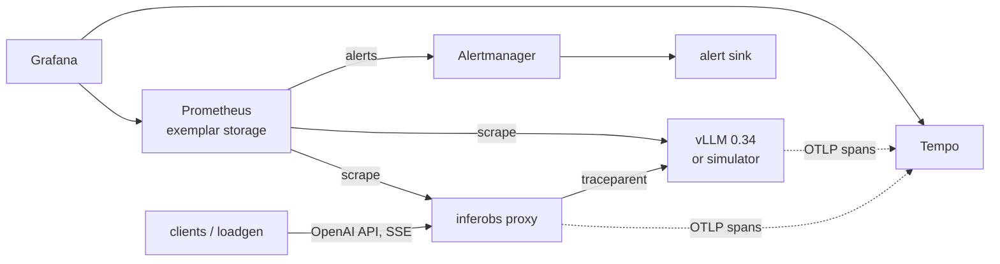

# inference-observability-stack

Observability for LLM inference serving, measured against a real engine: a streaming metering proxy,
SLO burn-rate alerting, distributed traces that cross into vLLM, and experiments that check whether
the numbers on the dashboard are the numbers callers actually got.

<!-- BEGIN GENERATED: setup -->
Measured on one NVIDIA GeForce RTX 3050 Ti Laptop GPU (4 GB), vLLM 0.34.0 serving Qwen2.5-0.5B-Instruct (bf16), on a shared 20-thread i7-12700H laptop (20 CPUs visible). Prometheus scrapes every 5 s. Workload: lognormal prompts (mean 256 words) and outputs (mean 128 tokens, `ignore_eos`).
<!-- END GENERATED: setup -->

## Results

<!-- BEGIN GENERATED: headline -->
_Results pending._
<!-- END GENERATED: headline -->

Every number in this README is generated by `scripts/gen_readme.py` from the CSVs in `results/`
(CI fails if the README and the results disagree).

## What it is



- **`inferobs proxy`** sits in front of any OpenAI-compatible engine and forwards requests and SSE
  streams unchanged while measuring what the caller experiences: time to first chunk (observed when
  the chunk arrives, not when the request ends), every gap between chunks, mean time per output
  token, duration and token usage. Metric names follow the OpenTelemetry GenAI semantic conventions
  (client side, v1.41.0). It asks the engine for stream usage and hides that extra chunk from clients
  that did not ask, bounds model-label cardinality, aborts the upstream request when a client
  disconnects, and labels failures (`timeout`, `connection_error`, `stream_interrupted`, HTTP status,
  `cancelled`). Each request gets a span whose trace context is forwarded to the engine, a trace-id
  exemplar on its histogram samples, and an optional JSON access-log line.
- **`inferobs sim`** is a continuous-batching engine simulator (FCFS admission, chunked prefill,
  KV-cache budget, linear step-cost model) that exposes vLLM 0.34's metric names and buckets and takes
  runtime faults (slowdown, error rate, hang). CI runs the whole stack on it without a GPU.
- **`inferobs loadgen`** generates open-loop (Poisson) or closed-loop streaming load and records
  per-request ground truth, measuring latency from each request's scheduled arrival so a backed-up
  client cannot hide queueing (coordinated omission).
- **`inferobs slo gen`** turns `slo/slo.yaml` into recording rules and multi-window, multi-burn-rate
  alerts (SRE workbook tiers: 14.4x over 1 h and 5 m pages, 6x over 6 h and 30 m pages, 3x and 1x
  tickets). Latency thresholds are checked against the histogram bucket bounds; `window_scale`
  compresses every window for lab use.
- **`deploy/`**: Docker Compose stack (Prometheus 3.5 with exemplar storage, Tempo 2.8, Grafana 12,
  Alertmanager, toxiproxy for network faults), a generated Grafana dashboard that puts the caller's
  view next to the engine's, symptom alerts, and promtool unit tests for every alert.

### SLOs

| SLO | objective | SLI (measured at the proxy) |
|---|---|---|
| availability | 99.5% | requests without an error; client cancellations excluded |
| ttfc | 99% | streaming requests whose first chunk arrives within 1 s |
| tpot | 99% | requests whose mean time per output token is at most 50 ms |

## Experiments

### 1. What metering costs

<!-- BEGIN GENERATED: overhead -->
_Not measured yet: run the `overhead` experiment (see Reproducing)._
<!-- END GENERATED: overhead -->

### 2. Do the caller, the proxy, Prometheus and vLLM agree?

<!-- BEGIN GENERATED: agreement -->
_Not measured yet: run the `agreement` experiment (see Reproducing)._
<!-- END GENERATED: agreement -->

### 3. How wrong are histogram quantiles with each bucket layout?

<!-- BEGIN GENERATED: buckets -->
_Not measured yet: run the `agreement` experiment (see Reproducing)._
<!-- END GENERATED: buckets -->

### 4. Saturation

<!-- BEGIN GENERATED: saturation -->
_Not measured yet: run the `saturation` experiment (see Reproducing)._
<!-- END GENERATED: saturation -->

### 5. Which signal catches which fault, and how fast?

<!-- BEGIN GENERATED: faults -->
_Not measured yet: run the `faults` experiment (see Reproducing)._
<!-- END GENERATED: faults -->

### 6. One request, one trace

<!-- BEGIN GENERATED: trace -->
_Not measured yet: run the `trace` experiment (see Reproducing)._
<!-- END GENERATED: trace -->

## Quick start

No GPU needed with the simulator:

```bash
make up-sim                      # proxy, simulator, Prometheus, Tempo, Alertmanager, Grafana
pip install -e '.[dev]'
inferobs loadgen --url http://127.0.0.1:28000 --model sim-llm --rate 10 --duration 120
# Grafana: http://127.0.0.1:28300, dashboard "LLM serving: caller vs engine"
make smoke                       # load the stack and verify metrics, exemplars, traces, dashboards
```

With vLLM on an NVIDIA GPU (defaults fit 4 GB: Qwen2.5-0.5B-Instruct):

```bash
make up-vllm
inferobs loadgen --url http://127.0.0.1:28000 --model qwen2.5-0.5b-instruct --rate 4 --duration 120
```

Add `-f deploy/compose.faults.yaml` to put toxiproxy between the proxy and the engine and load the
compressed-window SLO rules.

## Reproducing the results

```bash
make test lint promtool                 # unit tests, ruff, promtool rule tests
scripts/run_gpu_experiments.sh          # on a machine with the GPU: trace, saturation, agreement,
                                        # overhead (chunk a), then faults (chunk b)
python scripts/gen_readme.py            # rebuild this README from results/
```

Each experiment writes `results/<host>/<name>.csv` plus `<name>.meta.json` (commit, host, load
average, parameters). Raw per-request data goes to `runs/` (not committed).

## Layout

```text
inferobs/proxy/     metering proxy (SSE accounting, metrics, tracing)
inferobs/sim/       continuous-batching engine simulator with vLLM-compatible metrics
inferobs/loadgen/   open/closed-loop streaming load generator
inferobs/slo/       SLO rule generator
inferobs/exp/       experiments (overhead, agreement, saturation, faults, trace)
deploy/             compose stack, Prometheus rules and promtool tests, Grafana, Tempo, toxiproxy
slo/                SLO specs (production windows and the 1/12 lab windows)
scripts/            dashboard and README generators, smoke test, GPU experiment runner
```

## Limitations

- One small GPU (4 GB) and a 0.5B model: absolute latencies and capacity are specific to it. The
  methods (and the proxy, rules and dashboard) are not.
- The machine is shared with other work; tails are noisier than on a dedicated host. Load average is
  recorded with every result.
- Fault detection times use compressed SLO windows (1/12) so each fault takes minutes, not hours.
  With production windows the fast-burn page needs about 12 times longer to accumulate evidence.
- The proxy is a single Python process. It is meant to measure, not to replace a production gateway.
- The GenAI semantic conventions are still experimental; names are pinned to v1.41.0.

## License

MIT
